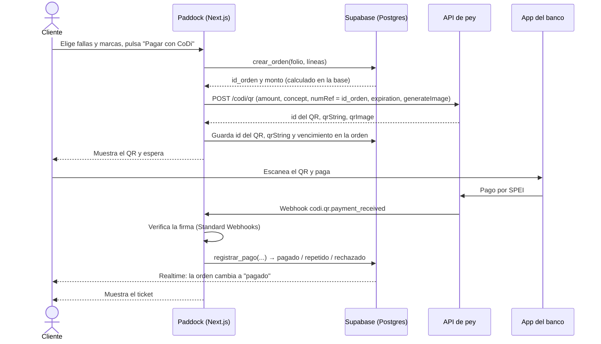

# Paddock · TallerToGo

Plataforma web para un taller mecánico especializado en **suspensión del Chevrolet Corvette Z06 2025**. El mecánico diagnostica el auto, el cliente elige qué reparar y con qué marca de refacción, y paga desde su celular con **CoDi** (cobro por QR del Banco de México) a través de la API de **pey**. Después sigue la reparación en vivo.

Proyecto para el hackatón de **pey CoDi** (noviembre de 2026). Equipo: Miguel Ángel (lado del cliente) y Rafael (lado del mecánico).

> **Paddock** es el nombre de la marca en la interfaz; **TallerToGo** es el nombre del repositorio.

---

## El problema

En un taller, el cliente suele recibir un presupuesto en papel o por WhatsApp, no sabe qué pieza exacta falla ni dónde está, tiene que aceptar todo o nada y paga en mostrador. Después no sabe en qué va su auto hasta que llama.

Paddock lo resuelve en un solo lugar:

- El diagnóstico llega **pieza por pieza y con su ubicación** (eje y lado).
- El cliente **elige qué reparar** y entre dos marcas de refacción (**OEM** o **GM**), con precio y mano de obra a la vista.
- Puede **pagar por partes**: compra hoy lo urgente y el resto después.
- Paga con **CoDi**: escanea un QR con la app de su banco, sin tarjeta y sin comisiones para el cliente.
- Ve el **avance en tiempo real**: enviado → pagado → en reparación → listo → entregado.

## Stack tecnológico

| Capa | Tecnología |
| --- | --- |
| Frontend | **Next.js 16** (App Router), **React 19**, **TypeScript** |
| Estilos | **Tailwind CSS 4**, tipografía Barlow / Barlow Condensed (`next/font`) |
| Base de datos | **Supabase** (PostgreSQL) con **Row Level Security** |
| Autenticación | **Supabase Auth** (correo y contraseña, con rol cliente o mecánico) |
| Tiempo real | **Supabase Realtime** (cambios de diagnóstico y de orden) |
| Pagos | **API de pey, modalidad CoDi** (QR + webhook) |
| Despliegue | **Vercel** |
| Diseño | **Figma** |

Un solo lenguaje (TypeScript) de punta a punta: la lógica de servidor vive en *route handlers* de Next.js y en funciones de Postgres.

## Funcionalidades

### Cliente

- **Registro e inicio de sesión** con nombre, apellidos, correo, teléfono y contraseña.
- **Registro de autos** (hasta 20 por cliente): modelo con buscador, placas y uno de los 10 colores de fábrica del Corvette Z06 2025.
- **Eliminar un auto** mientras el mecánico no haya empezado su diagnóstico, con un aviso de **"Deshacer"** de 6 segundos.
- **Ver el diagnóstico** de cada auto: descripción general y lista de fallas con la ubicación de cada pieza.
- **Elegir marca por pieza** (OEM o GM) y armar el carrito con el total de piezas + mano de obra.
- **Compras parciales**: varias órdenes por diagnóstico; cada falla se compra una sola vez. Si deja fallas sin elegir, un modal le recuerda que podrá pagarlas después.
- **Pago con CoDi** por QR y **ticket** de cada orden pagada.
- **Seguimiento en vivo** por auto (cada auto tiene su propio diagnóstico, recibo y avance).

### Mecánico

- Lista de autos por atender: **diagnostica por orden de llegada** y **repara por orden de pago**.
- **Formulario de diagnóstico** con folio (`DG-00000`), descripción general y fallas elegidas del catálogo (buscador y filtros por eje y lado), con la mano de obra de cada una.
- Enviar el diagnóstico al cliente y **avanzar el estado** de la reparación.
- Solo ve placas, color y folio; nunca los datos personales del cliente.

### Catálogo

42 piezas de suspensión del Corvette Z06 2025 (20 delanteras y 22 traseras), cada una en una **posición concreta** (eje y lado) y disponible en dos marcas: 84 precios en total. El catálogo está organizado por **sistema**, para poder agregar más sistemas del auto en el futuro.

## UI / UX

- **Estilo minimalista con aire automotriz**: fondo claro y neutro, tarjetas blancas y **un solo color de acento**, el amarillo *Accelerate* del Corvette (`#F2B705`).
- **Un solo botón de acento por pantalla** (la acción principal: "Entrar", "Enviar diagnóstico", "Pagar con CoDi"); los demás botones van solo con borde.
- **Tipografía Barlow**: Barlow Condensed para títulos, precios y botones; Barlow para el texto. Máximo dos pesos por pantalla.
- **Siempre hay respuesta visible**: cada acción muestra un mensaje de confirmación o de error claro, con ícono.
- **Errores reversibles**: acciones destructivas con "Deshacer" en vez de diálogos que interrumpen.
- **Seguimiento por auto** con pastillas (las placas) para cambiar de auto sin salir de la pantalla.
- **Accesibilidad**: combos con buscador navegables con teclado (ARIA *combobox*), botones de al menos 44 px de alto en celular y ningún texto menor a 14 px.

| Paleta "Pista" | Color |
| --- | --- |
| Fondo | `#F5F5F4` |
| Tarjetas | `#FFFFFF` |
| Bordes | `#E2E2E0` |
| Texto secundario | `#6B6F76` |
| Texto principal | `#111214` |
| Acento | `#F2B705` |

## Integración con CoDi (pey)

CoDi es el sistema de cobros digitales de Banxico sobre SPEI: el comercio genera un QR con un monto y el cliente lo paga desde la app de su banco. pey ofrece una API para generar esos QR y avisa con un **webhook** cuando el pago llega.

### Flujo de pago



### Cómo lo implementamos

1. **El servidor calcula el monto.** El navegador solo manda qué fallas y qué marca eligió. La función `crear_orden` de Postgres valida que el diagnóstico esté en `enviado` o `pagado`, que ninguna falla esté ya pagada, cancela el QR pendiente anterior y calcula el total con los precios de la base.
2. **Generar el QR** (route handler de Next.js, solo servidor): llama a `POST https://api.pey.mx/codi/qr` con `Authorization: Bearer <API key>`. Usamos el `id_orden` como `numRef` (solo dígitos, máximo 7) para relacionar el pago con la orden, `expiration` de al menos 360 segundos y `generateImage: true` para mostrar la imagen del QR.
3. **Esperar el pago**: la pantalla del QR escucha la orden con **Supabase Realtime**; en cuanto cambia a `pagado`, pasa al ticket sin que el cliente recargue.
4. **Recibir el webhook** `codi.qr.payment_received` en un route handler. Antes de tocar la base:
   - se verifica la firma **Standard Webhooks** (`webhook-id`, `webhook-timestamp`, `webhook-signature`) con el cuerpo crudo y el secreto del webhook;
   - se busca la orden por el id del QR y el `numRef`, y se comparan monto y vigencia.
5. **Registrar el pago** con la función `registrar_pago`, que solo puede ejecutar el servidor (llave secreta de Supabase):
   - **pagado**: la orden se marca pagada y, con el primer pago, el diagnóstico pasa a `pagado`;
   - **repetido**: un webhook duplicado se ignora;
   - **rechazado**: pago a un QR vencido o cancelado, tardío o con otro monto. Queda registrado, pero no se aplica (no hay reembolsos).

### Seguridad

- Solo la **confirmación de pey** marca una orden como pagada; el navegador nunca puede hacerlo.
- La API key de pey, el secreto del webhook y la llave secreta de Supabase viven **solo en variables de entorno del servidor**; nunca con el prefijo `NEXT_PUBLIC_` ni en el repositorio.
- Row Level Security: cada cliente solo ve sus autos, sus diagnósticos enviados y sus órdenes.
- Las CLABEs del hackatón no se suben al repositorio (es público).

### Estados

| Entidad | Flujo |
| --- | --- |
| Diagnóstico | borrador → enviado → pagado → en_reparacion → listo → entregado |
| Orden | pendiente → pagado / expirado / rechazado |

## Estructura del repositorio

```
tallertogo/
├── CLAUDE.md                 # Reglas del proyecto (fuente de verdad)
├── docs/
│   ├── base-de-datos.md      # Modelo E-R, tablas, funciones y SQL para Supabase
│   ├── catalogo-suspension-corvette-z06.md
│   └── contexto-proyecto.md
└── frontend/                 # App de Next.js
    ├── app/                  # login, registro, inicio (cliente), taller (mecánico)
    ├── components/           # Barra superior, avisos, buscador, seguimiento en vivo
    └── lib/supabase/         # Clientes de Supabase (navegador, servidor, admin)
```

## Cómo correrlo

Requisitos: Node.js 20 o más reciente y un proyecto de Supabase con el SQL de `docs/base-de-datos.md` ya ejecutado.

1. Crea `frontend/.env.local` con las llaves de tu proyecto de Supabase (ver `frontend/lib/supabase/`):

   ```
   NEXT_PUBLIC_SUPABASE_URL=...
   NEXT_PUBLIC_SUPABASE_PUBLISHABLE_KEY=...
   SUPABASE_SECRET_KEY=...
   ```

   Las llaves de pey se agregarán aquí mismo cuando se conecte el pago. No subas este archivo.

2. Instala y arranca:

   ```bash
   cd frontend
   npm install
   npm run dev
   ```

3. Abre http://localhost:3000.

## Estado del proyecto

- [x] Modelo de base de datos normalizado (3FN) y SQL en Supabase
- [x] Login y registro de clientes y trabajadores
- [x] Inicio del cliente: registro y eliminación de autos, seguimiento en vivo
- [x] Lista de autos del mecánico (con datos de ejemplo)
- [ ] Formulario de diagnóstico del mecánico conectado a la base
- [ ] Diagnóstico y carrito del cliente
- [ ] Pago con QR CoDi, webhook de pey y ticket
- [ ] Despliegue en Vercel
