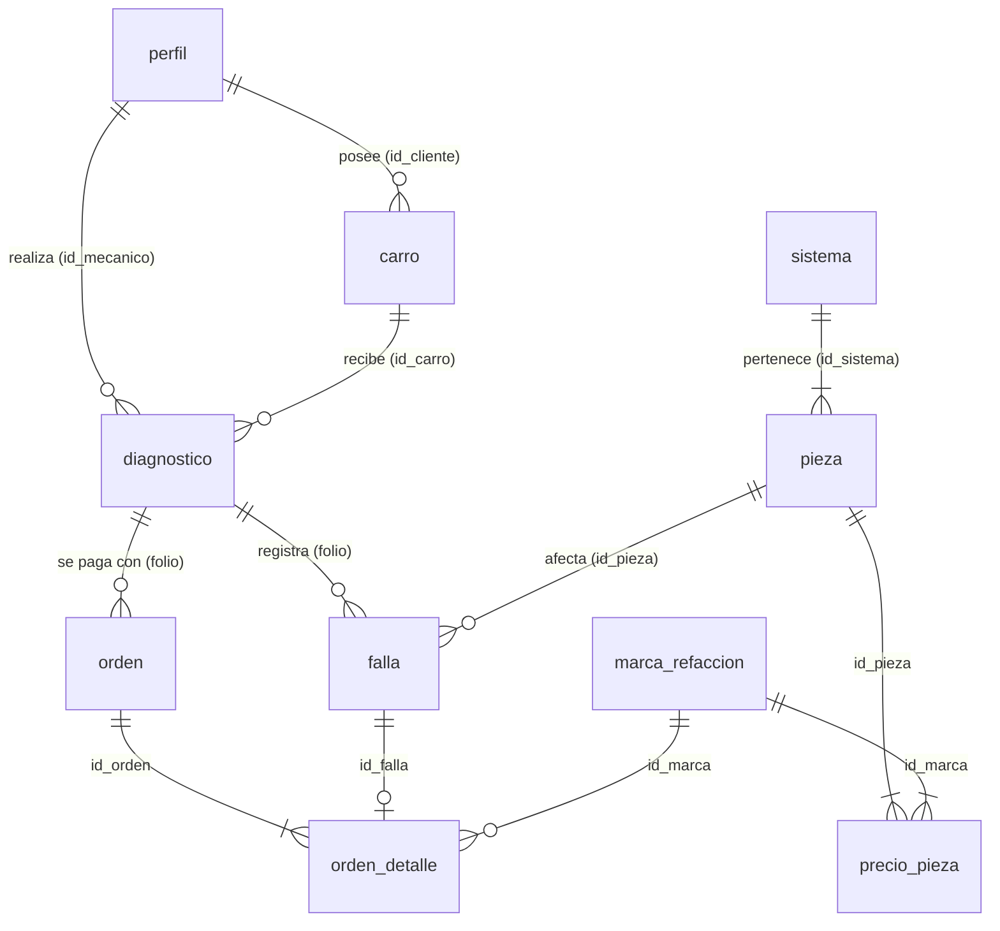

# Base de datos — TallerToGo

Modelo de datos de TallerToGo: modelo E-R, paso a tablas, diccionario de datos, conexiones entre tablas, mapa de pantallas y el SQL completo para Supabase (PostgreSQL).

- **Fuente de verdad del proyecto:** `CLAUDE.md`. Si algo de aquí lo contradice, manda el `CLAUDE.md`.
- **Documento de diseño con diagrama E-R:** https://claude.ai/artifact/KyUDxVvXMM7C6pPjNNc3vC
- **Estado:** SQL probado en PostgreSQL 16 (simulando `auth.users` y `auth.uid()` de Supabase). Falta correrlo en el proyecto de Supabase.

## Cómo usar este archivo para conectar una pantalla

1. Busca la pantalla en la **sección 7** (mapa de pantallas). Ahí dice qué tabla, vista o función usar y trae la consulta con `supabase-js`.
2. Si la pantalla necesita un dato que no está ahí, búscalo en el **diccionario de datos** (sección 4).
3. Para llegar a ese dato desde otra tabla, sigue las **llaves foráneas y rutas de join** de la sección 5.
4. Los importes se guardan en **centavos** (`int`). Para mostrarlos: `(centavos / 100).toLocaleString('es-MX', { style: 'currency', currency: 'MXN' })`.
5. Nunca calcules en el navegador un total que se vaya a cobrar: el monto lo calcula la función `crear_orden` en la base.

## 1. Reglas que respeta el modelo

- Un solo taller, especializado en suspensión, y un solo auto de demo: **Chevrolet Corvette Z06 2025** (C8), sin Front Lift. Marca, modelo y año del auto son constantes de la app, no columnas.
- Login con rol: `cliente` o `mecanico`. Solo hay una cuenta de mecánico, creada a mano.
- Hasta **3 autos por cliente**, cada uno con placa única y uno de los **10 colores de fábrica** del Z06 2025. No se pide VIN. Cada auto tiene sus propios diagnósticos, órdenes y seguimiento.
- 42 piezas-posición del catálogo (`docs/catalogo-suspension-corvette-z06.md`), cada una independiente (`SUS-DEL-05-IZQ` y `SUS-DEL-05-DER` son piezas distintas). Todas pertenecen al sistema Suspensión; la tabla `sistema` deja listo agregar otros.
- Dos marcas de refacción, **OEM** y **GM**, cada pieza con su precio en cada marca (84 precios). Demo: OEM = 2 ¢, GM = 1 ¢, mano de obra = 1 ¢ por falla.
- El mecánico registra cada **falla** (una pieza-posición defectuosa) con su descripción y su mano de obra. Una pieza-posición aparece a lo más una vez por diagnóstico.
- El cliente solo ve diagnósticos **enviados** de sus autos.
- **Compras parciales:** el cliente compra desde la vista del diagnóstico, eligiendo qué fallas pagar y la marca de cada una. Un diagnóstico puede pagarse en **varias órdenes** (mientras esté en `enviado` o `pagado`), pero **cada falla se compra una sola vez**. Si deja fallas sin elegir, la app muestra un modal ("Aún te faltan piezas del diagnóstico por comprar; podrás pagarlas después. ¿Quieres continuar?"). Cuando el diagnóstico pasa a `en_reparacion`, las fallas sin comprar quedan como `no_comprada`.
- Pago con CoDi vía pey. **Solo el webhook marca una orden como pagada.** Un pago repetido se ignora. **No hay reembolsos:** un pago a un QR cancelado o vencido, tardío o con otro monto queda como `rechazado` (registrado, pero no se aplica).

## 2. Modelo entidad-relación (conceptual)

Solo entidades del minimundo. `/atributo` = derivado (no se guarda); la sangría marca los componentes de un atributo compuesto; la llave primaria va primero.

| Entidad | Atributos |
| --- | --- |
| Usuario (superclase) | **id_usuario**, correo_electronico, contraseña, nombre_completo (nombre, apellido_paterno, apellido_materno), num_telefono, rol |
| Cliente (subclase de Usuario) | hereda todo de Usuario |
| Mecánico (subclase de Usuario) | hereda todo de Usuario |
| Carro | **id_carro**, placa (única), color |
| Diagnóstico | **folio**, estado, fecha_creacion, fecha_envio, /total |
| Falla | **id_falla**, descripcion, mano_obra, /estado_falla |
| Pieza | **id_pieza**, nombre, nombre_tecnico, posicion (eje, lado) |
| Sistema | **id_sistema**, nombre |
| Marca de refacción | **id_marca**, nombre |
| Orden (pago CoDi) | **id_orden**, monto, estado, codi_qr_id, qr_string, expira_en, transaction_id, fecha_pago, fecha_creacion, /num_ref |

Especialización Usuario → {Cliente, Mecánico}: disjunta y total.

| Relación | Entidades | Cardinalidad | Participación | Atributos de la relación |
| --- | --- | --- | --- | --- |
| posee | Cliente – Carro | 1:N (máximo 3) | Carro total | — |
| recibe | Carro – Diagnóstico | 1:N | Diagnóstico total | — |
| realiza | Mecánico – Diagnóstico | 1:N | Diagnóstico total | — |
| registra | Diagnóstico – Falla | 1:N | Falla total | — |
| afecta | Pieza – Falla | 1:N | Falla total | — |
| pertenece | Sistema – Pieza | 1:N | Pieza total | — |
| se ofrece en | Pieza – Marca de refacción | M:N | Ambas totales | nombre_comercial, precio |
| se paga con | Diagnóstico – Orden | 1:N (compras parciales y QR vencidos o cancelados) | Orden total | — |
| compra (ternaria) | Orden – Falla – Marca de refacción | 1 : N : 1 | Orden total, Falla parcial | — |

*compra* 1:N:1 = en una orden van N fallas; cada falla entra a lo más en una orden y con una sola marca. La falla sola determina la orden y la marca.

## 3. Paso del modelo E-R al relacional

8 entidades del minimundo → 10 tablas.

| Elemento del E-R | Regla aplicada | Resultado |
| --- | --- | --- |
| Usuario + Cliente + Mecánico | Especialización disjunta sin atributos propios en los subtipos → una tabla con atributo tipo | `perfil` (con `rol`). La contraseña queda solo en `auth.users` de Supabase |
| nombre_completo, posicion | Atributo compuesto → se guardan sus componentes | `nombre`, `apellido_paterno`, `apellido_materno`; `eje`, `lado` |
| Carro, Diagnóstico, Falla, Pieza, Sistema, Marca, Orden | Entidad fuerte → tabla | `carro`, `diagnostico`, `falla`, `pieza`, `sistema`, `marca_refaccion`, `orden` |
| posee, recibe, realiza, registra, afecta, pertenece, se paga con | 1:N → la llave del lado 1 pasa como FK al lado N | ver sección 5 |
| se ofrece en (M:N con atributos) | Tabla intermedia con PK compuesta | `precio_pieza(id_pieza, id_marca, …)` |
| compra (ternaria 1:N:1) | Tabla intermedia; la llave de la falla basta como PK | `orden_detalle(id_falla, id_orden, id_marca)` |
| /total, /estado_falla, /num_ref | Derivados → no se guardan | se calculan en vistas y funciones; `numRef` de pey = `id_orden` |

## 4. Diccionario de datos

Tipos de PostgreSQL. **PK** = llave primaria, **FK** = llave foránea, **UQ** = único. "Nulo: no" = obligatorio.

### perfil — usuarios (clientes y el mecánico)

| Columna | Tipo | Nulo | Llave | Descripción |
| --- | --- | --- | --- | --- |
| id_perfil | uuid | no | PK, FK → `auth.users.id` | Mismo id que el usuario de Supabase Auth (`auth.uid()`, `user.id`) |
| rol | varchar(8) | no | | `'cliente'` o `'mecanico'` |
| nombre | varchar(60) | no | | |
| apellido_paterno | varchar(60) | no | | |
| apellido_materno | varchar(60) | sí | | |
| correo | varchar(120) | no | UQ | Copia del correo de `auth.users` (se guarda al registrarse) |
| telefono | varchar(15) | no | | |

### carro — autos de los clientes

| Columna | Tipo | Nulo | Llave | Descripción |
| --- | --- | --- | --- | --- |
| id_carro | int (identity) | no | PK | |
| id_cliente | uuid | no | FK → `perfil.id_perfil` | Dueño del auto |
| placa | varchar(10) | no | UQ | |
| color | varchar(40) | no | | Uno de los 10 colores de fábrica (`check`): Arctic White, Black, Competition Yellow Tintcoat Metallic, Hysteria Purple Metallic, Rapid Blue, Red Mist Metallic Tintcoat, Riptide Blue Metallic, Sea Wolf Gray Tricoat, Sebring Orange Tintcoat, Torch Red |

Marca, modelo y año: constantes de la app (Chevrolet Corvette Z06 2025). Máximo 3 autos por cliente (política RLS `carro_registrar`).

### sistema — sistemas del auto

| Columna | Tipo | Nulo | Llave | Descripción |
| --- | --- | --- | --- | --- |
| id_sistema | smallint (identity) | no | PK | |
| nombre | varchar(40) | no | UQ | Hoy solo `'Suspensión'` |

### pieza — catálogo de piezas-posición (42 registros)

| Columna | Tipo | Nulo | Llave | Descripción |
| --- | --- | --- | --- | --- |
| id_pieza | varchar(16) | no | PK | ID del catálogo, p. ej. `SUS-DEL-05-IZQ` |
| id_sistema | smallint | no | FK → `sistema.id_sistema` | |
| nombre | varchar(100) | no | | Nombre en español, p. ej. "Coilover delantero izquierdo" |
| nombre_tecnico | varchar(100) | no | | Nombre en inglés / OEM |
| eje | varchar(9) | no | | `'DELANTERO'` o `'TRASERO'` |
| lado | varchar(9) | no | | `'IZQUIERDO'` (conductor), `'DERECHO'` (pasajero) o `'CENTRAL'` |

### marca_refaccion — marcas de refacción

| Columna | Tipo | Nulo | Llave | Descripción |
| --- | --- | --- | --- | --- |
| id_marca | smallint (identity) | no | PK | Con los datos de la demo: 1 = OEM, 2 = GM |
| nombre | varchar(20) | no | UQ | `'OEM'` o `'GM'` |

### precio_pieza — precio de cada pieza en cada marca (tabla intermedia, 84 registros)

| Columna | Tipo | Nulo | Llave | Descripción |
| --- | --- | --- | --- | --- |
| id_pieza | varchar(16) | no | PK, FK → `pieza.id_pieza` | |
| id_marca | smallint | no | PK, FK → `marca_refaccion.id_marca` | |
| nombre_comercial | varchar(130) | no | | Hoy "pieza + marca" |
| precio_centavos | int | no | | > 0 |

### diagnostico — revisión de un auto por el mecánico

| Columna | Tipo | Nulo | Llave | Descripción |
| --- | --- | --- | --- | --- |
| folio | int (identity) | no | PK | |
| id_carro | int | no | FK → `carro.id_carro` | |
| id_mecanico | uuid | no | FK → `perfil.id_perfil` | |
| estado | varchar(13) | no | | `borrador` → `enviado` → `pagado` → `en_reparacion` → `listo` → `entregado`. `pagado` solo lo pone el webhook |
| fecha_creacion | timestamptz | no | | Default `now()` |
| fecha_envio | timestamptz | sí | | Se llena al enviar al cliente |

### falla — cada pieza defectuosa que registra el mecánico

| Columna | Tipo | Nulo | Llave | Descripción |
| --- | --- | --- | --- | --- |
| id_falla | int (identity) | no | PK | |
| folio | int | no | FK → `diagnostico.folio` (cascade) | |
| id_pieza | varchar(16) | no | FK → `pieza.id_pieza` | |
| descripcion | text | no | | Qué encontró el mecánico |
| mano_obra_centavos | int | no | | ≥ 0; solo se cobra si el cliente compra la falla |

Restricción: `UNIQUE (folio, id_pieza)`.

### orden — intento de pago con CoDi (la orden pagada es el ticket)

| Columna | Tipo | Nulo | Llave | Descripción |
| --- | --- | --- | --- | --- |
| id_orden | int (identity) | no | PK | ≤ 9 999 999; se manda a pey como `numRef` (texto) |
| folio | int | no | FK → `diagnostico.folio` | |
| monto_centavos | int | no | | Lo calcula `crear_orden`; se valida contra el webhook |
| estado | varchar(9) | no | | `pendiente`, `pagado`, `expirado` (vencida o cancelada) o `rechazado` (pago inválido, sin reembolso) |
| codi_qr_id | varchar(64) | sí | UQ | `id` de la respuesta 201 de pey |
| qr_string | text | sí | | `qrString` de pey, para dibujar el QR |
| expira_en | timestamptz | no | | `now()` + 10 min (igual a la `expiration` = 600 s que se manda a pey) |
| transaction_id | varchar(64) | sí | UQ | Del webhook; evita procesar un pago dos veces |
| fecha_pago | timestamptz | sí | | `datePaid` del webhook |
| fecha_creacion | timestamptz | no | | Default `now()` |

### orden_detalle — qué fallas incluye la orden y con qué marca (tabla intermedia)

| Columna | Tipo | Nulo | Llave | Descripción |
| --- | --- | --- | --- | --- |
| id_falla | int | no | PK, FK → `falla.id_falla` | Una falla, en una sola orden |
| id_orden | int | no | FK → `orden.id_orden` (cascade) | |
| id_marca | smallint | no | FK → `marca_refaccion.id_marca` | Marca que eligió el cliente |

### Datos que no están en ninguna tabla

| Dato | De dónde sale |
| --- | --- |
| Marca, modelo y año del auto | Constante: Chevrolet Corvette Z06 2025 |
| Nombre del taller | Constante de la app |
| Contraseña | Solo en Supabase Auth |
| Total de un diagnóstico o carrito | Σ (`precio_pieza.precio_centavos` + `falla.mano_obra_centavos`) de lo elegido; columna `subtotal_centavos` de las vistas |
| Estado de cada falla | `v_diagnostico_cliente.estado_falla`: `disponible`, `en_pago`, `pagada` o `no_comprada` (diagnóstico ya en reparación) |
| `numRef` para pey | `id_orden` como texto |

## 5. Conexiones entre tablas



### Llaves foráneas

El nombre de la restricción sigue la convención de PostgreSQL (`<tabla>_<columna>_fkey`). Sirve para desambiguar en `supabase-js` cuando dos FK apuntan a la misma tabla (por ejemplo, a `perfil`).

| Columna | Apunta a | Restricción | Cardinalidad | Relación E-R |
| --- | --- | --- | --- | --- |
| `perfil.id_perfil` | `auth.users.id` | `perfil_id_perfil_fkey` | 1:1 | cuenta de Supabase |
| `carro.id_cliente` | `perfil.id_perfil` | `carro_id_cliente_fkey` | N:1 | posee |
| `diagnostico.id_carro` | `carro.id_carro` | `diagnostico_id_carro_fkey` | N:1 | recibe |
| `diagnostico.id_mecanico` | `perfil.id_perfil` | `diagnostico_id_mecanico_fkey` | N:1 | realiza |
| `falla.folio` | `diagnostico.folio` | `falla_folio_fkey` | N:1 | registra |
| `falla.id_pieza` | `pieza.id_pieza` | `falla_id_pieza_fkey` | N:1 | afecta |
| `pieza.id_sistema` | `sistema.id_sistema` | `pieza_id_sistema_fkey` | N:1 | pertenece |
| `precio_pieza.id_pieza` | `pieza.id_pieza` | `precio_pieza_id_pieza_fkey` | N:1 | se ofrece en |
| `precio_pieza.id_marca` | `marca_refaccion.id_marca` | `precio_pieza_id_marca_fkey` | N:1 | se ofrece en |
| `orden.folio` | `diagnostico.folio` | `orden_folio_fkey` | N:1 | se paga con |
| `orden_detalle.id_falla` | `falla.id_falla` | `orden_detalle_id_falla_fkey` | 1:1 (opcional) | compra |
| `orden_detalle.id_orden` | `orden.id_orden` | `orden_detalle_id_orden_fkey` | N:1 | compra |
| `orden_detalle.id_marca` | `marca_refaccion.id_marca` | `orden_detalle_id_marca_fkey` | N:1 | compra |

### Tablas intermedias

- **`precio_pieza`** resuelve la M:N Pieza–Marca. Para saber el precio de una falla con una marca: `falla.id_pieza` + `id_marca` → `precio_pieza`.
- **`orden_detalle`** resuelve la ternaria Orden–Falla–Marca. Para saber qué se compró: `orden` → `orden_detalle` → `falla` → `pieza`, y el precio con (`falla.id_pieza`, `orden_detalle.id_marca`) → `precio_pieza`.

### Rutas de join frecuentes

| Necesito… | Ruta |
| --- | --- |
| El cliente de un diagnóstico | `diagnostico.id_carro` → `carro.id_cliente` → `perfil` |
| El mecánico de un diagnóstico | `diagnostico.id_mecanico` → `perfil` |
| Las fallas de un diagnóstico con su ubicación | `falla.folio = diagnostico.folio` → `falla.id_pieza` → `pieza` (`eje`, `lado`) → `sistema` |
| Los precios OEM/GM de una falla | `falla.id_pieza` → `precio_pieza` → `marca_refaccion` |
| Si una falla ya se compró | `falla.id_falla` → `orden_detalle` → `orden.estado` |
| Los tickets de un diagnóstico | `orden` (`estado = 'pagado'`, mismo `folio`; puede haber varios) → `orden_detalle` → `falla` → `pieza` + `precio_pieza` |
| Los autos de un cliente (pastillas de placas del seguimiento) | `carro.id_cliente = auth.uid()` → `diagnostico` por `id_carro` |

## 6. Vistas y funciones

| Objeto | Tipo | Quién lo usa | Qué hace / devuelve |
| --- | --- | --- | --- |
| `v_diagnostico_cliente` | vista | cliente | Una fila por **falla × marca** de los diagnósticos no borrador: folio, `estado_diagnostico`, `fecha_envio`, placa, color, `mecanico`, `id_falla`, `sistema`, `id_pieza`, `pieza`, `eje`, `lado`, `descripcion`, `id_marca`, `marca`, `nombre_comercial`, `precio_centavos`, `mano_obra_centavos`, `subtotal_centavos`, `estado_falla` |
| `v_ticket` | vista | cliente, mecánico | Una fila por falla comprada de órdenes `pagado`: `num_ticket`, `transaction_id`, `fecha_pago`, `monto_centavos`, folio, placa, `cliente`, `mecanico`, `sistema`, `id_pieza`, `pieza`, `eje`, `lado`, `marca`, `precio_centavos`, `mano_obra_centavos`, `subtotal_centavos` |
| `crear_orden(p_folio int, p_lineas jsonb)` | función (RPC) | cliente, **con su sesión** (usa `auth.uid()`) | Valida que el diagnóstico sea suyo y esté en `enviado` o `pagado`, cancela un QR pendiente anterior, rechaza fallas ya pagadas, calcula el monto y crea la orden con sus líneas. Devuelve `id_orden`. `p_lineas = [{ "id_falla": 7, "id_marca": 1 }, …]` |
| `registrar_pago(p_codi_qr_id, p_transaction_id, p_monto_centavos, p_fecha_pago)` | función | solo el servidor (service role), desde el webhook | Devuelve `'pagado'`, `'repetido'`, `'rechazado'` o `'desconocido'` |
| `es_mecanico()` | función | políticas RLS | `true` si el usuario actual es el mecánico |

Las vistas usan `security_invoker`, así que respetan RLS: cada quien ve solo lo suyo.

## 7. Mapa de pantallas → datos

Pantallas del `CLAUDE.md` (sección 8). Ejemplos con `supabase-js` v2; `supabase` es el cliente con la sesión del usuario, salvo donde dice *service role*.

### Acceso

**Login**

| Dato | De dónde |
| --- | --- |
| Correo y contraseña | `supabase.auth.signInWithPassword({ email, password })` |
| Rol (para redirigir) y nombre | `perfil.rol`, `perfil.nombre` |

```js
const { data: { user } } = await supabase.auth.signInWithPassword({ email, password });
const { data: perfil } = await supabase
  .from('perfil').select('rol, nombre').eq('id_perfil', user.id).single();
// perfil.rol === 'mecanico' → pantallas del mecánico; 'cliente' → pantallas del cliente
```

**Registro de cliente**

| Dato del formulario | Columna |
| --- | --- |
| Correo, contraseña | `auth.signUp` (y el correo también en `perfil.correo`) |
| Nombre, apellidos, teléfono | `perfil.nombre`, `apellido_paterno`, `apellido_materno`, `telefono` |

```js
const { data: { user } } = await supabase.auth.signUp({ email, password });
await supabase.from('perfil').insert({
  id_perfil: user.id, rol: 'cliente', nombre, apellido_paterno, apellido_materno,
  correo: email, telefono,
});
```

La política RLS exige que exista la sesión al insertar el perfil. Para la demo, desactiven la confirmación de correo en la configuración de Auth de Supabase; si no, `signUp` no deja sesión y el `insert` falla.

**Registro de auto**

```js
// color: uno de los 10 colores de fábrica; un 4.º auto lo rechaza RLS
await supabase.from('carro').insert({ id_cliente: user.id, placa, color });
// Marca, modelo y año se muestran fijos: Chevrolet Corvette Z06 2025
```

### Mecánico

**Lista de autos y diagnósticos**

```js
// Diagnósticos con su auto y su cliente (más recientes primero)
const { data } = await supabase.from('diagnostico')
  .select(`folio, estado, fecha_creacion, fecha_envio,
           carro ( id_carro, placa, color,
                   cliente:perfil!carro_id_cliente_fkey ( nombre, apellido_paterno, telefono, correo ) )`)
  .order('fecha_creacion', { ascending: false });

// Autos registrados (para iniciar un diagnóstico nuevo)
const { data: autos } = await supabase.from('carro')
  .select('id_carro, placa, color, cliente:perfil!carro_id_cliente_fkey ( nombre, apellido_paterno )');

// Crear diagnóstico (queda en 'borrador')
const { data: diag } = await supabase.from('diagnostico')
  .insert({ id_carro, id_mecanico: user.id }).select('folio').single();
```

**Formulario de fallas**

| Dato | De dónde |
| --- | --- |
| Buscador de piezas | `pieza` (`id_pieza`, `nombre`, `nombre_tecnico`, `eje`, `lado`) + `sistema.nombre` |
| Fallas ya capturadas | `falla` del folio + `pieza` |
| Descripción y mano de obra | `falla.descripcion`, `falla.mano_obra_centavos` (1 en la demo) |

```js
const { data: catalogo } = await supabase.from('pieza')
  .select('id_pieza, nombre, nombre_tecnico, eje, lado, sistema ( nombre )')
  .order('id_pieza');

const { data: fallas } = await supabase.from('falla')
  .select('id_falla, id_pieza, descripcion, mano_obra_centavos, pieza ( nombre, eje, lado )')
  .eq('folio', folio);
// Ocultar del buscador las piezas que ya están en `fallas` (UNIQUE folio + id_pieza)

await supabase.from('falla').insert({ folio, id_pieza, descripcion, mano_obra_centavos: 1 });
await supabase.from('falla').delete().eq('id_falla', id_falla); // solo mientras está en borrador
```

**Enviar diagnóstico y avanzar la reparación**

```js
await supabase.from('diagnostico')
  .update({ estado: 'enviado', fecha_envio: new Date().toISOString() }).eq('folio', folio);
// Después del pago: 'en_reparacion' → 'listo' → 'entregado'. 'pagado' lo pone solo el webhook.
await supabase.from('diagnostico').update({ estado: 'en_reparacion' }).eq('folio', folio);
```

### Cliente

**Mis diagnósticos**

```js
const { data } = await supabase.from('diagnostico')
  .select('folio, estado, fecha_envio, carro ( placa )')
  .order('fecha_envio', { ascending: false });
// RLS ya filtra: solo sus autos y sin borradores
```

**Diagnóstico con fallas, selector OEM/GM y carrito**

| Dato en pantalla | Columna de `v_diagnostico_cliente` |
| --- | --- |
| Mecánico que hizo el diagnóstico | `mecanico` |
| Auto | `placa`, `color` (+ modelo fijo) |
| Cada falla y su ubicación | `id_falla`, `pieza`, `id_pieza`, `eje`, `lado`, `sistema`, `descripcion` |
| Precio por marca | `id_marca`, `marca`, `precio_centavos` (una fila por marca) |
| Mano de obra | `mano_obra_centavos` |
| Subtotal de la opción | `subtotal_centavos` |
| Si se puede elegir | `estado_falla = 'disponible'` (las `pagada` se muestran como compradas, con su ticket) |

```js
const { data: filas } = await supabase.from('v_diagnostico_cliente')
  .select('*').eq('folio', folio).order('id_falla').order('id_marca');
// Agrupar por id_falla: cada falla trae una fila OEM y una GM.
// Total del carrito (solo para mostrar) = suma de subtotal_centavos de la marca elegida en cada falla.
// Si quedan fallas 'disponible' sin elegir → modal: podrá pagarlas después en otra orden.
```

**Pagar**

```js
// 1) Con la sesión del cliente (crear_orden usa auth.uid())
const { data: id_orden, error } = await supabase.rpc('crear_orden', {
  p_folio: folio,
  p_lineas: seleccion.map(s => ({ id_falla: s.id_falla, id_marca: s.id_marca })),
});
// 2) En el servidor: leer orden.monto_centavos, llamar a pey POST /codi/qr
//    (amount = monto_centavos / 100, numRef = String(id_orden), expiration = 600, generateImage = true)
//    y guardar la respuesta con el cliente *service role*:
await supabaseAdmin.from('orden')
  .update({ codi_qr_id: qr.id, qr_string: qr.qrString }).eq('id_orden', id_orden);
```

**Pantalla del QR (espera el pago)**

```js
const { data: orden } = await supabase.from('orden')
  .select('id_orden, estado, monto_centavos, qr_string, expira_en')
  .eq('id_orden', id_orden).single();

supabase.channel(`orden-${id_orden}`)
  .on('postgres_changes',
      { event: 'UPDATE', schema: 'public', table: 'orden', filter: `id_orden=eq.${id_orden}` },
      ({ new: o }) => { /* 'pagado' → ticket; 'expirado' → botón para generar otro QR */ })
  .subscribe();
```

**Ticket**

| Dato | Columna de `v_ticket` |
| --- | --- |
| Número de ticket y pago | `num_ticket`, `transaction_id`, `fecha_pago`, `monto_centavos` |
| Cliente, mecánico, auto | `cliente`, `mecanico`, `placa`, `folio` |
| Renglones | `pieza`, `id_pieza`, `eje`, `lado`, `marca`, `precio_centavos`, `mano_obra_centavos`, `subtotal_centavos` |

```js
// Con compras parciales un diagnóstico puede tener varios tickets: agrupar por num_ticket
const { data: tickets } = await supabase.from('v_ticket').select('*').eq('folio', folio).order('num_ticket');
```

**Seguimiento en vivo**

```js
supabase.channel(`diag-${folio}`)
  .on('postgres_changes',
      { event: 'UPDATE', schema: 'public', table: 'diagnostico', filter: `folio=eq.${folio}` },
      ({ new: d }) => setEstado(d.estado))
  .subscribe();
```

### Servidor: webhook de pey

```js
// Después de verificar la firma (Standard Webhooks, cuerpo crudo), con service role:
const { data: resultado } = await supabaseAdmin.rpc('registrar_pago', {
  p_codi_qr_id: body.codiQrId,
  p_transaction_id: body.transactionId,
  p_monto_centavos: Math.round(body.amount * 100),
  p_fecha_pago: new Date(body.datePaid * 1000).toISOString(),
});
// 'pagado' | 'repetido' | 'rechazado' | 'desconocido'
```

La service role key va solo en variables de entorno del servidor, nunca en el navegador ni en el repo.

## 8. Normalización (resumen)

- **1FN:** `Diagnostico.piezas` era una lista → una fila por falla. `nombre_completo` → nombre y apellidos. Ticket y carrito repetían grupos de pieza/costo → una fila por falla comprada.
- **2FN:** en (folio, id_pieza) los datos de la pieza dependían solo de `id_pieza` → tabla `pieza`. En (id_pieza, id_marca) el nombre de la marca dependía solo de `id_marca` → tabla `marca_refaccion`; en `precio_pieza` quedan solo `nombre_comercial` y `precio_centavos`.
- **3FN:** se eliminaron las dependencias transitivas: `folio → id_carro → placa`, `id_orden → folio → cliente/mecánico`, `id_falla → id_pieza` + `(id_pieza, id_marca) → precio`, `id_pieza → id_sistema → nombre_sistema`. Los totales, el estado de cada falla y `numRef` son derivados.
- Excepciones a propósito: `orden.monto_centavos` (es lo que se cobró y se valida contra el webhook) y `diagnostico.estado` (lo cambia el mecánico a mano).

## 9. SQL completo

Correr en el SQL Editor de Supabase, en este orden.

### Paso 1: tablas

```sql
-- Perfiles: la contraseña la guarda solo Supabase Auth (auth.users)
create table perfil (
  id_perfil         uuid primary key references auth.users(id) on delete cascade,
  rol               varchar(8) not null check (rol in ('cliente','mecanico')),
  nombre            varchar(60) not null,
  apellido_paterno  varchar(60) not null,
  apellido_materno  varchar(60),
  correo            varchar(120) not null unique,   -- copia del correo de auth.users
  telefono          varchar(15) not null
);

-- El modelo es fijo en la demo: Chevrolet Corvette Z06 2025 (C8), sin Front Lift.
-- Hasta 3 autos por cliente (se valida en la política carro_registrar). Sin VIN.
create table carro (
  id_carro    int generated always as identity primary key,
  id_cliente  uuid not null references perfil(id_perfil),
  placa       varchar(10) not null unique,
  color       varchar(40) not null check (color in (      -- 10 colores de fábrica del Z06 2025
                'Arctic White', 'Black', 'Competition Yellow Tintcoat Metallic',
                'Hysteria Purple Metallic', 'Rapid Blue', 'Red Mist Metallic Tintcoat',
                'Riptide Blue Metallic', 'Sea Wolf Gray Tricoat', 'Sebring Orange Tintcoat',
                'Torch Red'))
);

create table sistema (
  id_sistema  smallint generated always as identity primary key,
  nombre      varchar(40) not null unique           -- 'Suspensión'; luego frenos, motor...
);

create table pieza (
  id_pieza        varchar(16) primary key,          -- 'SUS-DEL-05-IZQ'
  id_sistema      smallint not null references sistema(id_sistema),
  nombre          varchar(100) not null,
  nombre_tecnico  varchar(100) not null,
  eje             varchar(9) not null check (eje  in ('DELANTERO','TRASERO')),
  lado            varchar(9) not null check (lado in ('IZQUIERDO','DERECHO','CENTRAL'))
);

create table marca_refaccion (
  id_marca  smallint generated always as identity primary key,
  nombre    varchar(20) not null unique
);

create table precio_pieza (
  id_pieza          varchar(16) not null references pieza(id_pieza),
  id_marca          smallint    not null references marca_refaccion(id_marca),
  nombre_comercial  varchar(130) not null,
  precio_centavos   int not null check (precio_centavos > 0),
  primary key (id_pieza, id_marca)
);

create table diagnostico (
  folio           int generated always as identity primary key,
  id_carro        int  not null references carro(id_carro),
  id_mecanico     uuid not null references perfil(id_perfil),
  estado          varchar(13) not null default 'borrador'
    check (estado in ('borrador','enviado','pagado','en_reparacion','listo','entregado')),
  fecha_creacion  timestamptz not null default now(),
  fecha_envio     timestamptz
);

create table falla (
  id_falla            int generated always as identity primary key,
  folio               int not null references diagnostico(folio) on delete cascade,
  id_pieza            varchar(16) not null references pieza(id_pieza),
  descripcion         text not null,
  mano_obra_centavos  int not null check (mano_obra_centavos >= 0),
  unique (folio, id_pieza)            -- cada pieza-posición una sola vez por diagnóstico
);

create table orden (
  id_orden        int generated always as identity primary key
                  check (id_orden <= 9999999),     -- numRef de pey = id_orden (máx. 7 dígitos)
  folio           int not null references diagnostico(folio),
  monto_centavos  int not null check (monto_centavos > 0),
  estado          varchar(9) not null default 'pendiente'
    check (estado in ('pendiente','pagado','expirado','rechazado')),
  codi_qr_id      varchar(64) unique,              -- "id" de la respuesta 201 de pey
  qr_string       text,
  expira_en       timestamptz not null,
  transaction_id  varchar(64) unique,              -- del webhook; evita procesar un pago dos veces
  fecha_pago      timestamptz,
  fecha_creacion  timestamptz not null default now()
);
create table orden_detalle (
  id_falla  int primary key references falla(id_falla),   -- PK: una falla, una sola compra
  id_orden  int not null references orden(id_orden) on delete cascade,
  id_marca  smallint not null references marca_refaccion(id_marca)
);
```

### Paso 2: datos de la demo

```sql
insert into marca_refaccion (nombre) values ('OEM'), ('GM');
insert into sistema (nombre) values ('Suspensión');

insert into pieza (id_pieza, nombre, nombre_tecnico, eje, lado, id_sistema)
select v.*, s.id_sistema from (values
  ('SUS-DEL-01-IZQ', 'Horquilla superior delantera izquierda', 'Front Left Upper Control Arm', 'DELANTERO', 'IZQUIERDO'),
  ('SUS-DEL-01-DER', 'Horquilla superior delantera derecha', 'Front Right Upper Control Arm', 'DELANTERO', 'DERECHO'),
  ('SUS-DEL-02-IZQ', 'Horquilla inferior delantera izquierda', 'Front Left Lower Control Arm', 'DELANTERO', 'IZQUIERDO'),
  ('SUS-DEL-02-DER', 'Horquilla inferior delantera derecha', 'Front Right Lower Control Arm', 'DELANTERO', 'DERECHO'),
  ('SUS-DEL-03-IZQ', 'Rótula inferior delantera izquierda', 'Front Left Lower Ball Joint', 'DELANTERO', 'IZQUIERDO'),
  ('SUS-DEL-03-DER', 'Rótula inferior delantera derecha', 'Front Right Lower Ball Joint', 'DELANTERO', 'DERECHO'),
  ('SUS-DEL-04-IZQ', 'Mango / Portamangueta delantero izquierdo', 'Front Left Steering Knuckle', 'DELANTERO', 'IZQUIERDO'),
  ('SUS-DEL-04-DER', 'Mango / Portamangueta delantero derecho', 'Front Right Steering Knuckle', 'DELANTERO', 'DERECHO'),
  ('SUS-DEL-05-IZQ', 'Coilover delantero izquierdo', 'Front Left MagneRide Strut Assembly', 'DELANTERO', 'IZQUIERDO'),
  ('SUS-DEL-05-DER', 'Coilover delantero derecho', 'Front Right MagneRide Strut Assembly', 'DELANTERO', 'DERECHO'),
  ('SUS-DEL-06-IZQ', 'Base superior de amortiguador delantera izquierda', 'Front Left Upper Shock Mount', 'DELANTERO', 'IZQUIERDO'),
  ('SUS-DEL-06-DER', 'Base superior de amortiguador delantera derecha', 'Front Right Upper Shock Mount', 'DELANTERO', 'DERECHO'),
  ('SUS-DEL-07-CEN', 'Barra estabilizadora delantera', 'Front Sway Bar / Stabilizer Bar', 'DELANTERO', 'CENTRAL'),
  ('SUS-DEL-08-IZQ', 'Buje y abrazadera estabilizadora delantera izquierda', 'Front Left Sway Bar Bushing & Bracket', 'DELANTERO', 'IZQUIERDO'),
  ('SUS-DEL-08-DER', 'Buje y abrazadera estabilizadora delantera derecha', 'Front Right Sway Bar Bushing & Bracket', 'DELANTERO', 'DERECHO'),
  ('SUS-DEL-09-IZQ', 'Bieleta estabilizadora delantera izquierda', 'Front Left Sway Bar End Link', 'DELANTERO', 'IZQUIERDO'),
  ('SUS-DEL-09-DER', 'Bieleta estabilizadora delantera derecha', 'Front Right Sway Bar End Link', 'DELANTERO', 'DERECHO'),
  ('SUS-DEL-10-IZQ', 'Sensor de altura delantero izquierdo', 'Front Left Ride Height Sensor', 'DELANTERO', 'IZQUIERDO'),
  ('SUS-DEL-10-DER', 'Sensor de altura delantero derecho', 'Front Right Ride Height Sensor', 'DELANTERO', 'DERECHO'),
  ('SUS-DEL-11-CEN', 'Subchasis / Puente delantero', 'Front Suspension Cradle / Crossmember', 'DELANTERO', 'CENTRAL'),
  ('SUS-TRA-01-IZQ', 'Horquilla superior trasera izquierda', 'Rear Left Upper Control Arm', 'TRASERO', 'IZQUIERDO'),
  ('SUS-TRA-01-DER', 'Horquilla superior trasera derecha', 'Rear Right Upper Control Arm', 'TRASERO', 'DERECHO'),
  ('SUS-TRA-02-IZQ', 'Horquilla inferior trasera izquierda', 'Rear Left Lower Control Arm', 'TRASERO', 'IZQUIERDO'),
  ('SUS-TRA-02-DER', 'Horquilla inferior trasera derecha', 'Rear Right Lower Control Arm', 'TRASERO', 'DERECHO'),
  ('SUS-TRA-03-IZQ', 'Rótula inferior trasera izquierda', 'Rear Left Lower Ball Joint', 'TRASERO', 'IZQUIERDO'),
  ('SUS-TRA-03-DER', 'Rótula inferior trasera derecha', 'Rear Right Lower Ball Joint', 'TRASERO', 'DERECHO'),
  ('SUS-TRA-04-IZQ', 'Brazo de control de convergencia trasero izquierdo', 'Rear Left Toe Link', 'TRASERO', 'IZQUIERDO'),
  ('SUS-TRA-04-DER', 'Brazo de control de convergencia trasero derecho', 'Rear Right Toe Link', 'TRASERO', 'DERECHO'),
  ('SUS-TRA-05-IZQ', 'Mango / Portamangueta trasero izquierdo', 'Rear Left Knuckle / Upright', 'TRASERO', 'IZQUIERDO'),
  ('SUS-TRA-05-DER', 'Mango / Portamangueta trasero derecho', 'Rear Right Knuckle / Upright', 'TRASERO', 'DERECHO'),
  ('SUS-TRA-06-IZQ', 'Coilover trasero izquierdo', 'Rear Left MagneRide Strut Assembly', 'TRASERO', 'IZQUIERDO'),
  ('SUS-TRA-06-DER', 'Coilover trasero derecho', 'Rear Right MagneRide Strut Assembly', 'TRASERO', 'DERECHO'),
  ('SUS-TRA-07-IZQ', 'Base superior de amortiguador trasera izquierda', 'Rear Left Upper Shock Mount', 'TRASERO', 'IZQUIERDO'),
  ('SUS-TRA-07-DER', 'Base superior de amortiguador trasera derecha', 'Rear Right Upper Shock Mount', 'TRASERO', 'DERECHO'),
  ('SUS-TRA-08-CEN', 'Barra estabilizadora trasera', 'Rear Sway Bar / Stabilizer Bar', 'TRASERO', 'CENTRAL'),
  ('SUS-TRA-09-IZQ', 'Buje y abrazadera estabilizadora trasera izquierda', 'Rear Left Sway Bar Bushing & Bracket', 'TRASERO', 'IZQUIERDO'),
  ('SUS-TRA-09-DER', 'Buje y abrazadera estabilizadora trasera derecha', 'Rear Right Sway Bar Bushing & Bracket', 'TRASERO', 'DERECHO'),
  ('SUS-TRA-10-IZQ', 'Bieleta estabilizadora trasera izquierda', 'Rear Left Sway Bar End Link', 'TRASERO', 'IZQUIERDO'),
  ('SUS-TRA-10-DER', 'Bieleta estabilizadora trasera derecha', 'Rear Right Sway Bar End Link', 'TRASERO', 'DERECHO'),
  ('SUS-TRA-11-IZQ', 'Sensor de altura trasero izquierdo', 'Rear Left Ride Height Sensor', 'TRASERO', 'IZQUIERDO'),
  ('SUS-TRA-11-DER', 'Sensor de altura trasero derecho', 'Rear Right Ride Height Sensor', 'TRASERO', 'DERECHO'),
  ('SUS-TRA-12-CEN', 'Subchasis / Puente trasero', 'Rear Suspension Cradle / Crossmember', 'TRASERO', 'CENTRAL')
) as v(id_pieza, nombre, nombre_tecnico, eje, lado)
cross join sistema s where s.nombre = 'Suspensión';

-- 84 precios: cada pieza-posición en OEM ($0.02) y GM ($0.01)
insert into precio_pieza (id_pieza, id_marca, nombre_comercial, precio_centavos)
select p.id_pieza, m.id_marca, p.nombre || ' ' || m.nombre,
       case m.nombre when 'OEM' then 2 else 1 end
from pieza p cross join marca_refaccion m;
```

La cuenta del mecánico se crea a mano: primero el usuario en Supabase Auth y después su fila en `perfil` con `rol = 'mecanico'`.

### Paso 3: funciones de pago

```sql
-- El cliente manda las fallas elegidas y su marca; el servidor calcula el monto.
-- Compras parciales: un diagnóstico puede pagarse en varias órdenes, mientras esté en
-- 'enviado' o 'pagado'. Cada falla se compra una sola vez.
-- Un QR anterior sin pagar se cancela y libera sus fallas.
-- p_lineas = '[{"id_falla": 7, "id_marca": 1}, {"id_falla": 9, "id_marca": 2}]'
create or replace function crear_orden(p_folio int, p_lineas jsonb)
returns int language plpgsql security definer set search_path = public as $$
declare v_orden int; v_monto int; v_n int;
begin
  if not exists (select 1 from diagnostico d join carro c using (id_carro)
                  where d.folio = p_folio and c.id_cliente = auth.uid()
                    and d.estado in ('enviado','pagado')) then
    raise exception 'Diagnóstico no disponible para compra';
  end if;
  with previas as (
    update orden set estado = 'expirado'
     where folio = p_folio and estado = 'pendiente'
    returning id_orden)
  delete from orden_detalle where id_orden in (select id_orden from previas);
  select count(*), sum(pp.precio_centavos + f.mano_obra_centavos)
    into v_n, v_monto
    from jsonb_to_recordset(p_lineas) as l(id_falla int, id_marca smallint)
    join falla f         on f.id_falla = l.id_falla and f.folio = p_folio
    join precio_pieza pp on pp.id_pieza = f.id_pieza and pp.id_marca = l.id_marca
   where not exists (select 1 from orden_detalle od where od.id_falla = l.id_falla);
  if v_n = 0 or v_n <> jsonb_array_length(p_lineas) then
    raise exception 'Alguna falla ya se pagó o no es válida para este diagnóstico';
  end if;
  insert into orden (folio, monto_centavos, expira_en)
  values (p_folio, v_monto, now() + interval '10 minutes')
  returning id_orden into v_orden;
  insert into orden_detalle (id_falla, id_orden, id_marca)   -- la PK frena dobles compras
  select l.id_falla, v_orden, l.id_marca
    from jsonb_to_recordset(p_lineas) as l(id_falla int, id_marca smallint);
  return v_orden;
end $$;

-- Lo llama la ruta del webhook (service role) DESPUÉS de verificar la firma
create or replace function registrar_pago(p_codi_qr_id varchar, p_transaction_id varchar,
                                          p_monto_centavos int, p_fecha_pago timestamptz)
returns varchar language plpgsql as $$
declare o orden%rowtype;
begin
  select * into o from orden where codi_qr_id = p_codi_qr_id for update;
  if not found then return 'desconocido'; end if;
  if o.estado in ('pagado','rechazado') then return 'repetido'; end if;   -- se ignora
  -- Sin reembolsos: un pago de una orden cancelada, tardío o con otro monto
  -- queda registrado como 'rechazado' y no se aplica
  if o.estado = 'expirado' or p_fecha_pago > o.expira_en
     or p_monto_centavos <> o.monto_centavos then
    update orden set estado = 'rechazado', transaction_id = p_transaction_id,
                     fecha_pago = p_fecha_pago
     where id_orden = o.id_orden;
    delete from orden_detalle where id_orden = o.id_orden;
    return 'rechazado';
  end if;
  update orden set estado = 'pagado', transaction_id = p_transaction_id,
                   fecha_pago = p_fecha_pago
   where id_orden = o.id_orden;
  update diagnostico set estado = 'pagado' where folio = o.folio and estado = 'enviado';
  return 'pagado';
end $$;

revoke execute on function registrar_pago(varchar, varchar, int, timestamptz)
  from public, anon, authenticated;
```

### Paso 4: vistas

```sql
-- Lo que ve el cliente: una fila por falla y marca, con el estado de la falla
create view v_diagnostico_cliente with (security_invoker = true) as
select d.folio, d.estado as estado_diagnostico, d.fecha_envio,
       c.id_cliente, c.placa, c.color,
       m.nombre || ' ' || m.apellido_paterno as mecanico,
       f.id_falla, s.nombre as sistema, p.id_pieza, p.nombre as pieza, p.eje, p.lado, f.descripcion,
       mr.id_marca, mr.nombre as marca, pp.nombre_comercial,
       pp.precio_centavos, f.mano_obra_centavos,
       pp.precio_centavos + f.mano_obra_centavos as subtotal_centavos,
       case when o.estado = 'pagado'    then 'pagada'
            when o.estado = 'pendiente' then 'en_pago'
            when d.estado in ('enviado','pagado') then 'disponible'
            else 'no_comprada' end as estado_falla
from diagnostico d
join carro c            on c.id_carro = d.id_carro
join perfil m           on m.id_perfil = d.id_mecanico
join falla f            on f.folio = d.folio
join pieza p            on p.id_pieza = f.id_pieza
join sistema s          on s.id_sistema = p.id_sistema
join precio_pieza pp    on pp.id_pieza = f.id_pieza
join marca_refaccion mr on mr.id_marca = pp.id_marca
left join orden_detalle od on od.id_falla = f.id_falla
left join orden o          on o.id_orden = od.id_orden
where d.estado <> 'borrador';

-- El ticket: solo órdenes pagadas, con la marca que eligió el cliente
create view v_ticket with (security_invoker = true) as
select o.id_orden as num_ticket, o.transaction_id, o.fecha_pago, o.monto_centavos,
       d.folio, c.placa,
       u.nombre || ' ' || u.apellido_paterno as cliente,
       m.nombre || ' ' || m.apellido_paterno as mecanico,
       s.nombre as sistema, p.id_pieza, p.nombre as pieza, p.eje, p.lado, mr.nombre as marca,
       pp.precio_centavos, f.mano_obra_centavos,
       pp.precio_centavos + f.mano_obra_centavos as subtotal_centavos
from orden o
join diagnostico d      on d.folio = o.folio
join carro c            on c.id_carro = d.id_carro
join perfil u           on u.id_perfil = c.id_cliente
join perfil m           on m.id_perfil = d.id_mecanico
join orden_detalle od   on od.id_orden = o.id_orden
join falla f            on f.id_falla = od.id_falla
join pieza p            on p.id_pieza = f.id_pieza
join sistema s          on s.id_sistema = p.id_sistema
join marca_refaccion mr on mr.id_marca = od.id_marca
join precio_pieza pp    on pp.id_pieza = f.id_pieza and pp.id_marca = od.id_marca
where o.estado = 'pagado';
```

### Paso 5: seguridad por fila (RLS) y Realtime

```sql
create or replace function es_mecanico() returns boolean
language sql stable security definer set search_path = public as $$
  select exists (select 1 from perfil where id_perfil = auth.uid() and rol = 'mecanico');
$$;

alter table perfil          enable row level security;
alter table carro           enable row level security;
alter table sistema         enable row level security;
alter table pieza           enable row level security;
alter table marca_refaccion enable row level security;
alter table precio_pieza    enable row level security;
alter table diagnostico     enable row level security;
alter table falla           enable row level security;
alter table orden           enable row level security;
alter table orden_detalle   enable row level security;

-- Perfil: cada quien ve el suyo; todos ven al mecánico; el mecánico ve a todos
create policy perfil_ver on perfil for select
  using (id_perfil = auth.uid() or rol = 'mecanico' or es_mecanico());
create policy perfil_registrar on perfil for insert         -- el mecánico se crea a mano
  with check (id_perfil = auth.uid() and rol = 'cliente');

create policy carro_ver on carro for select
  using (id_cliente = auth.uid() or es_mecanico());
create policy carro_registrar on carro for insert           -- máximo 3 autos por cliente
  with check (id_cliente = auth.uid()
              and (select count(*) from carro c where c.id_cliente = auth.uid()) < 3);

-- Catálogo: solo lectura
create policy sistema_ver on sistema       for select using (true);
create policy pieza_ver  on pieza           for select using (true);
create policy marca_ver  on marca_refaccion for select using (true);
create policy precio_ver on precio_pieza    for select using (true);

-- Diagnóstico: el cliente no ve borradores; 'pagado' solo lo pone registrar_pago
create policy diag_ver on diagnostico for select
  using (es_mecanico() or (estado <> 'borrador' and exists (
         select 1 from carro c where c.id_carro = diagnostico.id_carro
                                 and c.id_cliente = auth.uid())));
create policy diag_crear on diagnostico for insert
  with check (es_mecanico() and id_mecanico = auth.uid() and estado = 'borrador');
create policy diag_avanzar on diagnostico for update
  using (es_mecanico()) with check (es_mecanico() and estado <> 'pagado');

-- Fallas: el mecánico las edita solo mientras el diagnóstico es borrador
create policy falla_ver on falla for select
  using (exists (select 1 from diagnostico d where d.folio = falla.folio));
create policy falla_editar on falla for all
  using (es_mecanico() and exists (select 1 from diagnostico d
         where d.folio = falla.folio and d.estado = 'borrador'))
  with check (es_mecanico() and exists (select 1 from diagnostico d
         where d.folio = falla.folio and d.estado = 'borrador'));

-- Órdenes: solo lectura; se crean y cambian con las funciones de pago
create policy orden_ver on orden for select
  using (exists (select 1 from diagnostico d where d.folio = orden.folio));
create policy detalle_ver on orden_detalle for select
  using (exists (select 1 from orden o where o.id_orden = orden_detalle.id_orden));

-- Seguimiento en vivo
alter publication supabase_realtime add table diagnostico, orden;
```

## 10. Pendientes

- [ ] Correr el SQL en el proyecto de Supabase.
- [ ] Decidir si se fuerza el orden de los estados del diagnóstico con un trigger (hoy RLS solo impide que el mecánico ponga `pagado`).
